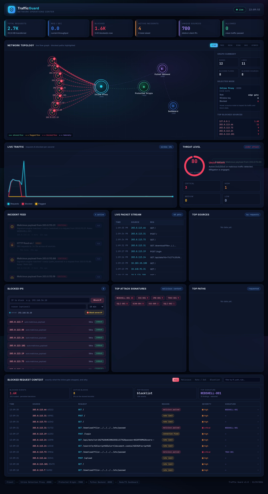

# TrafficGuard

**Real-time server traffic monitoring with inline DoS/DDoS and malicious-payload detection — built for a two-machine lab.**

TrafficGuard is a complete, runnable project that demonstrates how to protect a server with a *detection gate that sits directly in the traffic path*. Every request must pass through the detection proxy before it is allowed to reach the protected origin, so attacks are stopped at the edge instead of merely being observed after the fact.

The system is split across two machines exactly as the brief requires:

| Machine | Role | Stack |
|---------|------|-------|
| **Laptop 1** | Ubuntu Server VM (VirtualBox) running the protected target **and** the inline detection proxy | Python 3, `asyncio` raw sockets, stdlib only |
| **Laptop 2** | Monitoring / analytics / dashboard | **Python** backend (FastAPI + SQLite + WebSocket) and **Node.js + TypeScript** frontend |



---

## 1. What it does

TrafficGuard watches every connection and every byte that flows toward the protected server and answers three questions in real time:

1. **Is this traffic malicious?** A signature engine inspects the request line, headers, body, and URL-decoded / base64-decoded payloads for SQL injection, cross-site scripting, path traversal, command injection, SSRF, XXE, SSTI, Log4Shell, CRLF injection, request smuggling, webshells, reverse shells, scanner fingerprints, EICAR, NOP sleds, executable headers and high-entropy packed blobs.
2. **Is this a denial-of-service attempt?** A sliding-window engine tracks per-IP request rate, volumetric bytes, concurrent connections, unique destination ports, authentication failures, and the same-path request rate. It also correlates *many distinct sources* into a single DDoS fan-in incident, and can ingest raw packet observations (SYN / UDP / ICMP floods, port scans) from an optional Scapy sensor.
3. **Should the request reach the server?** Only clean traffic is forwarded to the origin. Malicious or rate-abusive traffic is rejected at the proxy with a JSON error and a `X-Blocked-By: traffic-guard` header, the offending source is optionally blocklisted, and an event is streamed to the dashboard.

Everything is surfaced live: a Node.js + TypeScript dashboard receives a WebSocket snapshot every second, renders a live traffic chart, a threat-level gauge, an incident feed, a packet stream, top sources / paths / attack signatures, and the blocked-IP list.

---

## 2. Architecture

```
                         LAPTOP 1  (Ubuntu Server VM)                    LAPTOP 2
 ┌──────────────────────────────────────────────────────────────┐   ┌───────────────────────────┐
 │                                                              │   │                           │
 │   client / attacker                                          │   │   Node.js + TypeScript    │
 │        │                                                     │   │   dashboard  :3000        │
 │        │  TCP :8080                                          │   │        │  (serves UI,      │
 │        ▼                                                     │   │        │   proxies /api    │
 │  ┌───────────────────────────┐    only clean traffic          │   │        │   and /ws)        │
 │  │  Inline Detection Proxy   │───────────────┐               │   │        ▼                  │
 │  │  (Python asyncio sockets) │               │               │   │   Python backend :8000    │
 │  │                           │               │               │   │   FastAPI + SQLite + WS   │
 │  │  1. blocklist check       │               │               │   │        ▲                  │
 │  │  2. connection-flood check│               │               │   │        │ events (HTTP POST)│
 │  │  3. request framing       │               │               │   │        │ blocklist (GET)   │
 │  │  4. rate-limit window     │               │  events       │   │        │                  │
 │  │  5. malicious inspection  │───────────────┼───────────────┼───┘        │                  │
 │  │  6. forward / reject      │               │               │            │                  │
 │  └───────────────────────────┘               ▼               │            │                  │
 │        │  forward                       ┌──────────────┐     │            │                  │
 │        └──────────────────────────────▶ │  Protected   │     │            │                  │
 │                                         │  Origin      │     │            │                  │
 │                                         │  :9000       │     │            │                  │
 │                                         │ (loopback    │     │            │                  │
 │                                         │  only)       │     │            │                  │
 │                                         └──────────────┘     │            │                  │
 │                                                              │            │                  │
 │   optional Scapy sensor ── raw packets ──────────────────────┼────────────┘                  │
 └──────────────────────────────────────────────────────────────┘                              │
                                                                                               │
                                          browser ◀──────────── WebSocket snapshots ───────────┘
```

**Key point:** the protected origin binds to `127.0.0.1:9000` and is never exposed. The only public entry point is the detection proxy on `:8080`. If the proxy is down, the server is unreachable — which is exactly the property you want from an inline gate.

See [`docs/ARCHITECTURE.md`](docs/ARCHITECTURE.md) for the full data-flow and algorithm description.

---

## 3. Feature summary

**Inline detection proxy (Laptop 1)**
- Hand-written HTTP/1.1 parsing over `asyncio` streams (no framework in the hot path).
- Per-IP and global sliding-window rate limiting.
- Concurrent-connection cap per IP (slowloris / half-open flood).
- Blocklist with TTL, two-tier: local decisions plus a remote list synced from the dashboard.
- Signature-based malicious-payload inspection with nested URL and base64 decoding.
- Response framing that understands `Content-Length` and `Transfer-Encoding: chunked`.
- Non-blocking event reporting to the backend (batched, bounded queue, never stalls traffic).
- Optional `X-Forwarded-For` trust mode for deployments behind a trusted load balancer.

**Monitoring backend (Laptop 2, Python)**
- DoS/DDoS detection engine: per-IP rate, volumetric bytes, DDoS fan-in, HTTP flood on a single path, slowloris, port scan, brute force, and malicious-payload incidents.
- Raw-packet sensor (Scapy) for SYN / UDP / ICMP floods and port scans.
- Incident lifecycle: de-duplication, cooldown, severity escalation, auto-resolve after inactivity, acknowledgement.
- SQLite persistence (WAL) for events, incidents and blocks.
- FastAPI REST API + WebSocket broadcast (1 snapshot/sec plus pushed incidents).
- Auto-blocking of offending sources with a configurable TTL.

**Dashboard (Laptop 2, Node.js + TypeScript)**
- Express server that serves the static UI and reverse-proxies `/api` and `/ws` to the Python backend.
- Live traffic chart (canvas, no chart library), threat gauge, KPI row.
- Incident feed with severity tags and one-click acknowledgement.
- Live packet stream, top sources, top paths, top attack signatures, blocked-IP management.
- **Manual IP block section** — type any IPv4/IPv6 address, an optional reason and a duration (1 min → permanent) and click **Block IP**. The panel also shows the configured protected-server IP and offers a one-click **⛔ Block server IP** shortcut that quarantines the origin (`TG_SERVER_IP`) immediately. Blocks are written to the shared SQLite blocklist, pushed to every open dashboard over WebSocket (`blocklist_changed`), and picked up by the Laptop 1 proxy on its next 5-second poll — so a block typed on Laptop 2 takes effect at the edge without a restart.

**Tooling**
- `tools/benign_traffic.py` — realistic clean traffic generator.
- `tools/screenshot.py` — headless dashboard capture.

---

## 4. Repository layout

```
.
├── laptop1-server/                 # LAPTOP 1 — Ubuntu Server VM
│   ├── protected_server.py         #   protected HTTP origin (asyncio, 127.0.0.1:9000)
│   ├── detection_proxy.py          #   inline detection gate (0.0.0.0:8080 -> :9000)
│   ├── malicious.py                #   signature engine (shared with backend)
│   ├── config.json                 #   proxy / limits / policy configuration
│   ├── requirements.txt            #   stdlib only (scapy optional)
│   ├── setup_ubuntu.sh             #   installer: user, /opt, systemd, UFW
│   └── systemd/
│       ├── traffic-origin.service
│       └── traffic-guard.service
│
├── laptop2-monitor/                # LAPTOP 2 — monitoring machine
│   ├── backend/                    #   Python analytics backend
│   │   ├── main.py                 #     FastAPI app, REST + WebSocket
│   │   ├── detector.py             #     DoS/DDoS detection engine
│   │   ├── malicious.py            #     signature engine
│   │   ├── sniffer.py              #     optional Scapy packet sensor
│   │   ├── database.py             #     SQLite store (WAL)
│   │   ├── config.py               #     thresholds + settings (env-overridable)
│   │   ├── requirements.txt
│   │   └── run.sh
│   └── frontend/                   #   Node.js + TypeScript dashboard
│       ├── src/server.ts           #     Express + REST/WS reverse proxy
│       ├── public/
│       │   ├── index.html
│       │   ├── css/styles.css
│       │   └── js/app.js
│       ├── package.json
│       └── tsconfig.json
│
├── tools/                          # simulators and utilities
├── docs/                           # architecture, setup, rules, screenshot
└── README.md
```

---

## 5. Quick start — single machine (fastest way to see it work)

You can run the entire system on one Linux machine for evaluation. The services use different ports, so there are no conflicts.

```bash
# 0) prerequisites
python3 --version        # 3.10+
node --version           # 18+
pip install -r laptop2-monitor/backend/requirements.txt
pip install websockets   # uvicorn WS support (already in uvicorn[standard])

# 1) start the Python monitoring backend  (terminal A)
cd laptop2-monitor/backend
uvicorn main:app --host 0.0.0.0 --port 8000

# 2) start the protected origin           (terminal B)
cd laptop1-server
python3 protected_server.py --port 9000

# 3) start the inline detection proxy     (terminal C)
cd laptop1-server
python3 detection_proxy.py --listen-port 8080 --upstream-port 9000 \
        --monitor-url http://127.0.0.1:8000

# 4) start the Node/TS dashboard          (terminal D)
cd laptop2-monitor/frontend
npm install
npm run build
PORT=3000 BACKEND_URL=http://127.0.0.1:8000 node dist/server.js
```

Open **http://localhost:3000**. In a fifth terminal, generate low-rate benign traffic against the local proxy:

```bash
python3 tools/benign_traffic.py --host 127.0.0.1 --port 8080 --rps 2 --duration 30
```

A convenience launcher is also provided:

```bash
./run_local_demo.sh          # starts all four services, then prints the URL
```

---

## 6. Two-machine setup (the intended deployment)

The full lab uses two physical laptops (or one host with two VirtualBox VMs) connected by a **host-only network** on `192.168.56.0/24`.

| Host | Address | Services |
|------|---------|----------|
| Laptop 1 (Ubuntu Server VM) | `192.168.56.10` | origin `:9000` (loopback), proxy `:8080` (public) |
| Laptop 2 (monitor) | `192.168.56.20` | backend `:8000`, dashboard `:3000` |

**Laptop 1** — install Ubuntu Server in VirtualBox, attach a host-only adapter, then:

```bash
sudo ./laptop1-server/setup_ubuntu.sh
```

The script installs dependencies, creates a `trafficguard` system user, copies the code to `/opt/traffic-guard`, installs and enables two hardened systemd units, and configures UFW to allow **only SSH (22) and the proxy (8080)**. Port 9000 is deliberately never opened.

**Laptop 2** — install the backend and frontend:

```bash
pip install -r laptop2-monitor/backend/requirements.txt
cd laptop2-monitor/frontend && npm install && npm run build
```

Start the backend with `uvicorn main:app --host 0.0.0.0 --port 8000`, then the dashboard with `PORT=3000 BACKEND_URL=http://127.0.0.1:8000 node dist/server.js`.

Finally, point Laptop 1's proxy at Laptop 2 by editing `laptop1-server/config.json`:

```json
"monitor": { "url": "http://192.168.56.20:8000", "enabled": true }
```

Full VirtualBox and networking instructions are in [`docs/SETUP_VIRTUALBOX.md`](docs/SETUP_VIRTUALBOX.md).

---

## 7. Configuration

### Proxy (`laptop1-server/config.json`)

```json
{
  "proxy":   { "listen_host": "0.0.0.0", "listen_port": 8080 },
  "upstream":{ "host": "127.0.0.1", "port": 9000 },
  "monitor": { "url": "http://192.168.56.20:8000", "enabled": true },
  "limits": {
    "window_seconds": 10,
    "max_requests_per_ip": 40,
    "max_requests_global": 500,
    "max_concurrent_per_ip": 12,
    "max_payload_bytes": 65536,
    "header_timeout": 5.0,
    "block_ttl_seconds": 300
  },
  "policy": {
    "block_on_malicious": true,
    "block_on_rate_limit": true,
    "block_on_conn_limit": true,
    "min_block_severity": "medium",
    "trust_forwarded_for": false,
    "malicious_blocklist_threshold": 3
  }
}
```

`trust_forwarded_for` is **off by default** because trusting a client-supplied header would let a client evade per-IP limits. Enable it only behind a trusted load balancer that overwrites this header.

### Backend (`laptop2-monitor/backend/config.py`)

Every setting is overridable with a `TG_` environment variable, for example:

```bash
TG_DOS_REQUESTS_PER_IP=50 TG_AUTO_BLOCK=true TG_SNIFFER_ENABLED=true uvicorn main:app
```

| Variable | Default | Meaning |
|----------|---------|---------|
| `TG_HOST` / `TG_PORT` | `0.0.0.0` / `8000` | bind address |
| `TG_WINDOW_SECONDS` | `10` | sliding window |
| `TG_DOS_REQUESTS_PER_IP` | `25` | per-IP DoS threshold |
| `TG_DOS_BYTES_PER_IP` | `2000000` | per-IP volumetric threshold |
| `TG_DDOS_UNIQUE_SOURCES` | `8` | sources that constitute a DDoS fan-in |
| `TG_DDOS_TOTAL_REQUESTS` | `60` | requests in the window for DDoS |
| `TG_HTTP_FLOOD_SAME_PATH` | `40` | same-path flood threshold |
| `TG_SLOWLORIS_CONCURRENT` | `10` | concurrent connections per IP |
| `TG_PORT_SCAN_UNIQUE_PORTS` | `15` | unique ports per IP |
| `TG_BRUTE_FORCE_FAILURES` | `10` | 401s per IP |
| `TG_AUTO_BLOCK` | `true` | auto-block offending IPs |
| `TG_AUTO_BLOCK_TTL` | `600` | block duration (seconds) |
| `TG_SNIFFER_ENABLED` | `false` | enable the Scapy packet sensor |
| `TG_DEMO_MODE` | `false` | generate synthetic traffic |

---

## 8. REST & WebSocket API

| Method | Path | Purpose |
|--------|------|---------|
| `GET` | `/api/health` | service health, uptime, engine + DB summary |
| `POST` | `/api/events` | ingest a batch of events `{ "events": [...] }` |
| `GET` | `/api/events?limit=&verdict=&src_ip=` | recent events |
| `GET` | `/api/incidents?limit=&status=` | incidents + active + stats |
| `POST` | `/api/incidents/{id}/ack` | acknowledge an incident |
| `GET` | `/api/stats` | full live snapshot (same shape as the WS snapshot) |
| `GET` | `/api/blocked` | current blocklist |
| `POST` | `/api/blocked` | add a block `{ "ip", "reason", "ttl" }` (validated IPv4/IPv6, `ttl: 0` = permanent) |
| `POST` | `/api/blocked/server?ttl=&reason=` | quarantine the protected origin (`TG_SERVER_IP`) in one call |
| `DELETE` | `/api/blocked/{ip}` | remove a block |
| `GET` | `/api/rules` | malicious-signature catalogue |
| `GET` | `/api/config` | effective thresholds |
| `POST` | `/api/engine/reset` | reset in-memory counters |
| `WS` | `/ws` | live snapshots + pushed incidents |

WebSocket message types: `snapshot`, `incident`, `incident_resolved`, `events`, `packet_alert`, `blocklist_changed`, `hello`, `pong`.

---

## 9. Detection engines

### Malicious content

The signature engine (`malicious.py`) runs the same code on the proxy and the backend. It inspects the request line, every header, and the body, then recursively decodes URL-encoding and base64 (depth 2) and rescans. Findings are ranked `low → medium → high → critical`; anything at or above `min_block_severity` is blocked. A Shannon-entropy check flags long high-entropy blobs that look packed or encrypted.

Categories include SQL injection, XSS, path traversal, command injection, SSRF, XXE, SSTI, Log4Shell, CRLF injection, HTTP request smuggling, webshells, reverse shells, scanner user-agents, EICAR, NOP sleds, and PE/ELF headers. The full rule table is in [`docs/DETECTION_RULES.md`](docs/DETECTION_RULES.md).

### DoS / DDoS

The detection engine (`detector.py`) keeps a per-source event deque inside a sliding window and evaluates, in order:

1. malicious-payload incidents,
2. per-IP request-rate DoS,
3. brute force (401 counting),
4. slowloris (concurrent connections),
5. port scan (unique destination ports),
6. HTTP flood on a single path,
7. DDoS fan-in (unique sources + total requests),
8. volumetric bytes.

Each incident is de-duplicated by a stable key, cooled down, escalated in severity on repeat, and auto-resolved after inactivity. The optional Scapy sensor adds `syn_flood`, `udp_flood`, `icmp_flood` and packet-level port-scan detections.

---

## 10. Safe local verification

Run the services as described above, then generate low-rate benign traffic against the local proxy:
```bash
python3 tools/benign_traffic.py --host 127.0.0.1 --port 8080 --rps 2 --duration 30
```

Expected results: benign traffic returns `200`/`404` and is counted as *allowed*. Detection rules and rate limits are exercised by the configured deployment; do not generate test traffic against systems you do not own or administer.

---

## 11. Security notes

- The origin binds to loopback only; the proxy is the sole public entry point.
- systemd units run with `NoNewPrivileges`, `ProtectSystem=strict`, a dedicated user, and only the capabilities they need.
- UFW allows only SSH and the proxy port; the origin port is never exposed.
- `trust_forwarded_for` is disabled by default to prevent rate-limit evasion.
- The blocklist is two-tier: local decisions plus a dashboard-managed remote list, so an operator can push blocks to the edge.
- This is an educational / lab project. For production, add TLS termination, authentication on the dashboard and API, persistent rate-limit state, and upstream health checks.

---

## 12. Troubleshooting

| Symptom | Cause / fix |
|---------|-------------|
| Dashboard shows "Reconnecting…" | The backend WebSocket needs the `websockets` package. `pip install websockets` and restart uvicorn. |
| `502 backend_unreachable` on `/api/*` | Python backend is not running on `BACKEND_URL`. |
| Every request returns `504` | The origin is not closing responses; ensure `protected_server.py` sends `Connection: close` and breaks after one response. |
| Benign `curl` traffic blocked | `curl` is a low-severity tool UA (`SCAN-004`) and should be allowed; real attack tools (`sqlmap`, `nikto`, …) are blocked. |
| Local IP blocked during testing | High-severity findings blocklist the source after `malicious_blocklist_threshold` hits. `DELETE /api/blocked/<ip>` and restart the proxy to clear the local list. |
| DDoS mode shows no distinct sources | `trust_forwarded_for` is off. Use `backend-ddos` or enable it in `config.json`. |

---

## 13. License

MIT. Built as a complete reference implementation of an inline, real-time DoS/DDoS and malicious-content detection system.
